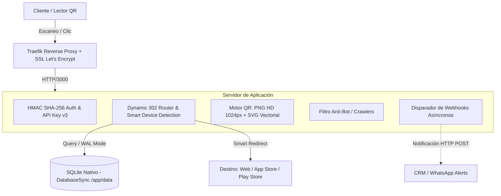

# Shlink Acortador & Motor QR Dinámico para Impresión

## Resumen Ejecutivo

**Shlink Acortador** es una plataforma en la nube de nivel de producción creada para resolver una de las limitaciones críticas del marketing impreso y digital: la rigidez de los códigos QR estáticos. Cuando una empresa imprime cientos o miles de tarjetas comerciales, folletos, flyers o etiquetas de empaque con un código QR convencional hacia una URL fija, cualquier cambio de dominio, campaña o producto inutiliza por completo el material impreso.

Esta solución introduce un **motor dinámico de redirección 302 de ultra-baja latencia** con soporte nativo para **edición en caliente**, permitiendo modificar la URL de destino instantáneamente desde un panel de control seguro sin volver a incurrir en costos de imprenta. Adicionalmente, implementa compatibilidad directa con la especificación **Shlink API v3**, permitiendo que aplicaciones satélite como **Tarjetas de Contactos Pro (Linktree)** y sistemas de mensajería generen URLs cortas y códigos QR programáticamente mediante cabeceras `X-Api-Key`.

---

## Arquitectura del Sistema

---

## Especificaciones y Capacidades Técnicas

### 1. Motor QR Dual para Imprenta y Digital
- **Vectorial SVG Puro (`/slug/qr?format=svg`):** Sin pixelación a cualquier escala, ideal para gigantografías, señalética, rotulación y corte láser en imprentas.
- **Raster HD PNG (`/slug/qr?format=png&size=1024`):** Resolución de 1024x1024 px con nivel de corrección de error **H (30% de redundancia)**, garantizando lectura incluso si el material impreso sufre raspaduras o suciedad.
- **Personalización Cromática Dinámica:** Permite personalizar los colores frontal (`qr_color_dark`) y de fondo (`qr_color_light`) mediante query params o configuración persistente.

### 2. Smart Routing y Enrutamiento Condicional
- Redirección adaptativa según el dispositivo del usuario: URLs diferenciadas para **iOS (App Store)**, **Android (Google Play)** y **Desktop**.
- Reglas de expiración temporal por fecha/hora y límite numérico de escaneos (cuponeras o promociones flash con URL de fallback).
- Enlaces protegidos por contraseña cifrada mediante tokens HMAC de corta duración.
- Inyección automática de etiquetas de rastreo **UTM** (`utm_source`, `utm_medium`, `utm_campaign`) conservando o concatenando query params originales (`forward_query`).

### 3. Persistencia de Alta Concurrencia con `node:sqlite`
- Utiliza la nueva biblioteca nativa síncrona de Node.js `node:sqlite` (`DatabaseSync`), eliminando dependencias binarias externas propensas a fallas de compilación C++.
- Configurado con `PRAGMA journal_mode = WAL` (Write-Ahead Logging) para lecturas no bloqueantes y escrituras atómicas seguras.
- Sistema de auto-migraciones de esquema seguro al iniciar el contenedor.

### 4. Compatibilidad Shlink API v3
- Implementa el estándar `POST /rest/v3/short-urls`, permitiendo conectar clientes existentes de Shlink o paneles externos suministrando una `X-Api-Key` o Bearer Token.

---

## Despliegue e Infraestructura

| Componente | Especificación Técnica |
| :--- | :--- |
| **Plataforma VPS** | Oracle Cloud Infrastructure (Ampere A1 ARM64) |
| **Contenedor** | Docker Node.js 22 Alpine Multi-Architecture |
| **Orquestación** | Coolify PaaS autohospedado |
| **Seguridad de Red** | Reverse Proxy Traefik con certificados automáticos Let's Encrypt |
| **Almacenamiento** | Docker Volume persistente montado en `/app/data` |
| **Health Monitoring** | Endpoint `/health` con sondeo nativo de Docker cada 30 segundos |
